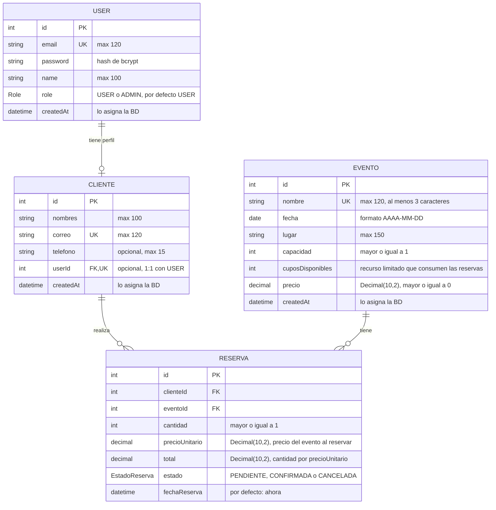

# Modelo ER del emprendimiento · Grupo G02

> Actividad 3 de la sesión 4. Es la base del `schema.prisma` del Lab 2 y de las relaciones del Lab 3.

**Emprendimiento:** KromaEvents · catálogo de eventos y reserva de cupos.

## Diagrama

Edítalo en https://mermaid.live (GitHub lo muestra como diagrama).

## Entidades

| Entidad | Tabla | Atributos (tipo) | Clave primaria | Únicos / obligatorios / reglas |
|---|---|---|---|---|
| User | `users` | id (int), email (string), password (string), name (string), role (enum `Role`), createdAt (datetime) | id (autoincremental) | `email` único; `password` guarda el hash de bcrypt y nunca se devuelve en las respuestas; `role` por defecto `USER` |
| Cliente | `clientes` | id (int), nombres (string), correo (string), telefono (string), userId (int), createdAt (datetime) | id (autoincremental) | `correo` único y obligatorio; `nombres` obligatorio; `telefono` opcional; `userId` único y opcional (perfil 1:1 del usuario) |
| Evento | `eventos` | id (int), nombre (string), fecha (date), lugar (string), capacidad (int), cuposDisponibles (int), precio (decimal), createdAt (datetime) | id (autoincremental) | `nombre` único y obligatorio (3 o más caracteres); `fecha`, `lugar`, `capacidad` y `precio` obligatorios; `capacidad` >= 1; `precio` >= 0; `cuposDisponibles` empieza igual a `capacidad` y baja con cada reserva |
| Reserva | `reservas` | id (int), clienteId (int), eventoId (int), cantidad (int), precioUnitario (decimal), total (decimal), estado (enum `EstadoReserva`), fechaReserva (datetime) | id (autoincremental) | `clienteId` y `eventoId` obligatorios (claves foráneas); `cantidad` >= 1 y no mayor que los `cuposDisponibles` del evento; `estado` por defecto `PENDIENTE`; `fechaReserva` por defecto la fecha actual |

## Relaciones

| Entidad A | Cardinalidad | Entidad B | Clave foránea | onDelete | Por qué |
|---|---|---|---|---|---|
| User | 1:1 | Cliente | `clientes.user_id` (única) | Cascade | El cliente es el perfil del usuario y no tiene sentido sin él: si se borra el usuario, se borra su perfil. |
| Cliente | 1:N | Reserva | `reservas.cliente_id` | Restrict | Las reservas son el historial de ventas y de cupos; no se puede borrar un cliente que tiene reservas (la API responde 409). |
| Evento | 1:N | Reserva | `reservas.evento_id` | Restrict | Un evento con reservas tiene asistentes y pagos asociados; borrarlo dejaría reservas huérfanas, así que se impide (409). |
| Cliente | N:M (a través de Reserva) | Evento | `reservas.cliente_id` + `reservas.evento_id` | Restrict (en ambas FK) | Un cliente asiste a varios eventos y un evento recibe a muchos clientes; Reserva es la tabla intermedia explícita porque guarda datos propios (cantidad, precio, total y estado). |

Como la FK de Cliente hacia User es Cascade pero la de Reserva hacia Cliente es Restrict, un usuario que ya tiene reservas tampoco se puede borrar: se conserva el historial.

## Mapeo a la base de datos

| Elemento | Dónde | Para qué |
|---|---|---|
| `enum Role` | `users.role` | Solo permite los roles `USER` y `ADMIN` |
| `enum EstadoReserva` (`@@map("estado_reserva")`) | `reservas.estado` | Solo permite `PENDIENTE`, `CONFIRMADA` y `CANCELADA` |
| `Decimal @db.Decimal(10, 2)` | `eventos.precio`, `reservas.precio_unitario`, `reservas.total` | Dinero exacto, sin errores de redondeo de `Float` (la API lo devuelve como texto, por ejemplo `"15"` o `"3.75"`) |
| `DateTime @db.Date` / `DateTime` | `eventos.fecha` / `reservas.fecha_reserva`, `created_at` | Fecha del evento sin hora; fecha y hora exactas de la reserva |
| `@@index([eventoId, estado])` | `reservas` | Índice compuesto para buscar las reservas activas de un evento |
| `@@index([estado, fechaReserva])` | `reservas` | Índice compuesto para el listado de administración filtrado por estado y rango de fechas |
| `@@index([clienteId])` | `reservas` | Listar rápido las reservas de un cliente |
| `@map` / `@@map` | Todas las tablas | Columnas y tablas en snake_case (`cupos_disponibles`, `fecha_reserva`, `reservas`) |

## ¿Qué se implementa en cada laboratorio?

- **Lab 2:** la entidad principal (**Evento**) y una segunda entidad (**Cliente**) en `schema.prisma`, sin relaciones.
- **Lab 3:** la entidad **User** (autenticación) con su perfil **Cliente** (1:1), la entidad **Reserva** y las relaciones (`@relation`) 1:N con Evento y con Cliente, que juntas forman la N:M entre Evento y Cliente. La reserva consume los `cuposDisponibles` del evento dentro de una transacción.
