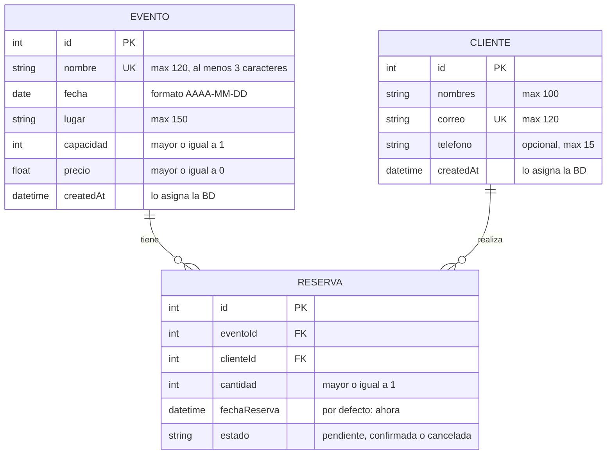

# Modelo ER del emprendimiento · Grupo G02

> Actividad 3 de la sesión 4. Es la base del `schema.prisma` del Lab 2 y de las relaciones del Lab 3.

**Emprendimiento:** KromaEvents · catálogo de eventos y reserva de cupos.

## Diagrama

Edítalo en https://mermaid.live (GitHub lo muestra como diagrama).

## Entidades

| Entidad | Atributos (tipo) | Clave primaria | Únicos / obligatorios / reglas |
|---|---|---|---|
| Evento | id (int), nombre (string), fecha (date), lugar (string), capacidad (int), precio (float), createdAt (datetime) | id (autoincremental) | `nombre` único y obligatorio (3 o más caracteres); `fecha`, `lugar`, `capacidad` y `precio` obligatorios; `capacidad` >= 1; `precio` >= 0 |
| Cliente | id (int), nombres (string), correo (string), telefono (string), createdAt (datetime) | id (autoincremental) | `correo` único y obligatorio; `nombres` obligatorio; `telefono` opcional |
| Reserva | id (int), eventoId (int), clienteId (int), cantidad (int), fechaReserva (datetime), estado (string) | id (autoincremental) | `eventoId` y `clienteId` obligatorios (claves foráneas); `cantidad` >= 1 y no mayor que los cupos libres del evento; `fechaReserva` por defecto la fecha actual; `estado` por defecto `pendiente` |

## Relaciones

| Entidad A | Cardinalidad (1:1, 1:N, N:M) | Entidad B | Ejemplo en una frase |
|---|---|---|---|
| Evento | 1:N | Reserva | Un evento tiene muchas reservas y cada reserva pertenece a un solo evento. |
| Cliente | 1:N | Reserva | Un cliente realiza muchas reservas y cada reserva la hace un solo cliente. |
| Evento | N:M (a través de Reserva) | Cliente | Un cliente puede asistir a varios eventos y un evento recibe a muchos clientes; Reserva es la tabla intermedia. |

## ¿Qué se implementa en cada laboratorio?

- **Lab 2:** la entidad principal (**Evento**) y una segunda entidad (**Cliente**) en `schema.prisma`, sin relaciones.
- **Lab 3:** la entidad **Reserva** y las relaciones (`@relation`) 1:N con Evento y con Cliente, que juntas forman la N:M entre Evento y Cliente.
