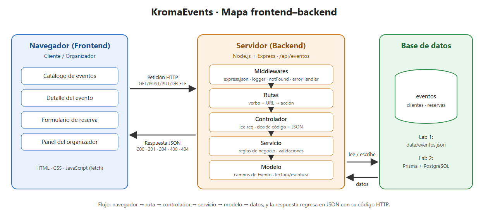

# Propuesta del emprendimiento · Grupo G03

> Actividad 1 de la sesión 1. Complétala antes del Paso 1 del laboratorio.

| Campo | Respuesta |
|---|---|
| Nombre del emprendimiento | KromaEvents |
| Problema que resuelve | Las personas que quieren asistir a conciertos, talleres, ferias o conferencias deben buscar la información en redes sociales dispersas y reservar su cupo por mensajes o llamadas, sin saber cuántos lugares quedan. Los organizadores llevan las reservas a mano, lo que provoca sobreventa de cupos y errores. KromaEvents centraliza en una página web el catálogo de eventos y la reserva de cupos. |
| Usuarios (quién lo usa) | Clientes que buscan y reservan cupos en eventos, y organizadores (administradores de KromaEvents) que publican los eventos y controlan las reservas. |
| 3 funciones principales | 1. Publicar y administrar eventos (nombre, fecha, lugar, capacidad y precio).   2. Consultar el catálogo de eventos disponibles y el detalle de cada uno.   3. Reservar cupos en un evento y consultar las reservas realizadas. |

## Mapa frontend–backend

El navegador (frontend) envía peticiones HTTP con JSON al servidor Express (backend), que las procesa en capas MVC y lee o escribe los datos; la respuesta vuelve con un código de estado y JSON.

## Entidades (3) y atributos principales

| Entidad | Atributos | ¿Se relaciona con…? |
|---|---|---|
| Evento | id, nombre, fecha, lugar, capacidad, precio | Reserva (un evento tiene muchas reservas) |
| Cliente | id, nombres, correo, telefono | Reserva (un cliente realiza muchas reservas) |
| Reserva | id, eventoId, clienteId, cantidad, fechaReserva, estado | Evento y Cliente (cada reserva pertenece a un evento y a un cliente) |

> La primera entidad es la que implementan en este laboratorio (4 o más campos). Las otras dos se usan en los Labs 2 y 3.

## 3 endpoints iniciales

| Verbo | Ruta | Código de estado |
|---|---|---|
| GET | /api/eventos | 200 |
| GET | /api/eventos/:id | 200 (404 si no existe) |
| POST | /api/eventos | 201 (400 si los datos no son válidos) |
