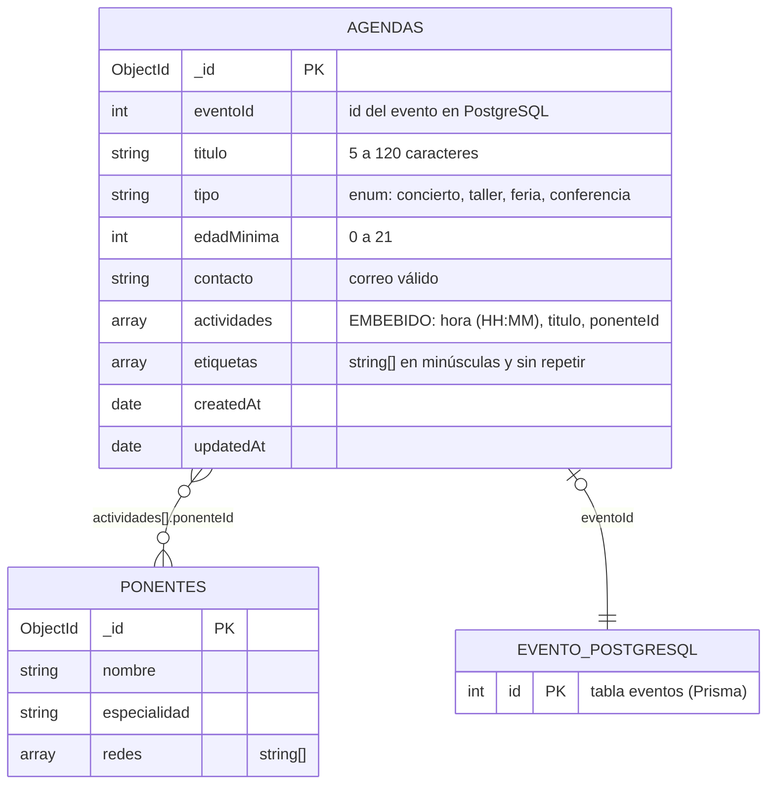

# Hito 2 · Workload y modelo documental

**Grupo:** G02  **Emprendimiento:** KromaEvents  **Colección elegida (hito 1):** `agendas`

## 1. Workload

| Actor | Operación | Lectura o escritura | Frecuencia (por día/hora) | Datos que usa |
|---|---|---|---|---|
| Visitante o cliente | Ver la agenda completa de un evento en su página de detalle | Lectura | ~2 000 por día (picos de 300 por hora antes de un concierto) | `agendas` por `eventoId`: actividades, horario, edad mínima y nombre del ponente de cada actividad |
| Cliente | Buscar eventos por etiqueta o tipo (ej. "jazz", "taller") | Lectura | ~500 por día | `agendas.etiquetas`, `agendas.tipo` |
| Organizador (ADMIN) | Crear la agenda de un evento nuevo | Escritura | 2–5 por semana | Documento completo de `agendas` con sus actividades embebidas |
| Organizador (ADMIN) | Cambiar la hora o el título de una actividad | Escritura | 5–10 por semana (más el día anterior al evento) | Un elemento de `agendas.actividades` |
| Organizador (ADMIN) | Registrar o actualizar la biografía y redes de un ponente o artista | Escritura | 1–3 por semana | `ponentes` |

**Conclusión:** el sistema lee mucho más de lo que escribe (cientos de lecturas por cada escritura). Conviene que la agenda se lea en **una sola consulta**, sin juntar varias tablas.

## 2. Relaciones: embeber o referenciar

| Relación | Cardinalidad | ¿Se lee junto? | ¿Cambia seguido? | ¿Crece sin límite? | Decisión |
|---|---|---|---|---|---|
| Agenda → Actividades | 1:N (pocas: 3 a 15 por evento) | Sí, siempre se muestra la agenda completa | Poco (solo ajustes de hora) | No, un evento tiene un número acotado de actividades | Embebida (`actividades[]`) |
| Actividad ↔ Ponente | N:M (un ponente participa en varios eventos y un evento tiene varios ponentes) | A veces (solo el nombre en la agenda) | Sí, la biografía y las redes se actualizan | Sí, el catálogo de ponentes crece con cada evento | Referenciada (`actividades[].ponenteId` → `ponentes`) |
| Agenda → Evento (PostgreSQL) | 1:1 | No desde Mongo; el evento se lee con Prisma | Sí (cupos y precio cambian con cada reserva) | No | Referenciada por id (`eventoId`, sin copiar datos) |

## 3. ER de MongoDB

Lo embebido se dibuja DENTRO de la entidad (`campo[]`); lo referenciado, como caja aparte unida con una línea (`*_id`).

## 4. Playground (`grupo02.mongodb.js`)

- [x] `createCollection` con `$jsonSchema`: 1 `enum` (`tipo`), 1 rango (`edadMinima` de 0 a 21) y 1 arreglo (`actividades` con `minItems: 1`)
- [x] 2 inserts válidos y 2 rechazados (con el mensaje y el campo que falló)
- [x] `$lookup` entre `agendas` y `ponentes` (con `$unwind` de las actividades)
